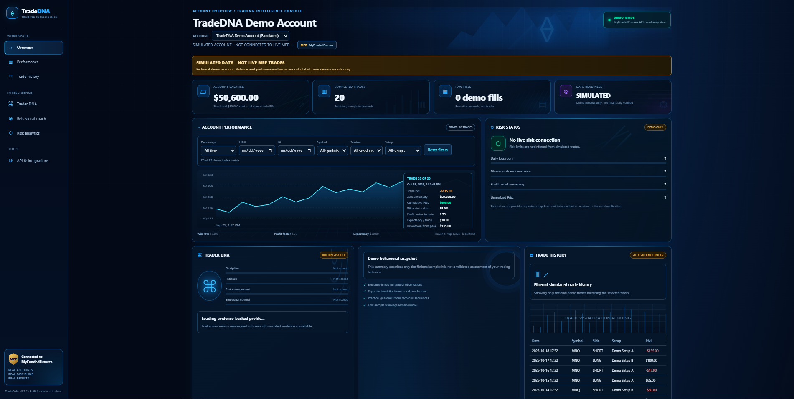

# TradeDNA — Prop Trading Data & Behavioral Analytics

TradeDNA is a personal Python and FastAPI project focused on organizing proprietary trading account data, reconstructing trading activity, and supporting performance analysis and behavioral review.

The project demonstrates practical work in API development, data integration, data quality, testing, and the design of tools for the proprietary trading industry.

## API Documentation Preview

*Screenshot of the TradeDNA API documentation interface. This is a visual portfolio example; it does not imply that a live API is publicly hosted.*

## Project Overview

TradeDNA explores how raw trading account data can be transformed into structured information that is easier to inspect, validate, and analyze.

Key areas of focus include:

- **API development:** Building REST API endpoints with Python and FastAPI.
- **Trading data integration:** Retrieving and organizing account, order, and fill data.
- **Trade reconstruction:** Developing the workflow for converting raw fills into reconstructed trades.
- **Data quality:** Identifying incomplete, inconsistent, or invalid records before using them for analysis.
- **Testing:** Using automated tests to check application behavior and reduce regressions.
- **Behavioral analytics:** Establishing a foundation for reviewing trading activity and identifying potential behavioral patterns.

## Technical Stack

- **Language:** Python
- **API framework:** FastAPI
- **API documentation:** OpenAPI / Swagger UI
- **Testing:** pytest
- **Data formats:** JSON and structured trading records

## Selected Work Samples

### 1. Prop Firm Plan Example

[View the sample JSON file](samples/prop-firm-plan-example.json)

An illustrative structured example demonstrating how proprietary trading account plan information can be represented in JSON.

The example uses fictional data and is intended to demonstrate data organization, not to represent a live account or a verified provider specification.

### 2. Data Quality Checks

[View the data quality checklist](samples/data-quality-checks.md)

A checklist covering considerations for validating trading data before using it for reporting or analysis, including completeness, consistency, and the treatment of questionable records.

### 3. Testing Results

[View the testing results](samples/testing-results.md)

A summary of the recorded automated testing results, including the testing scope and relevant limitations.

The documented test results relate to the tested release and environment. They should not be interpreted as proof that every integration, financial calculation, or production deployment has been independently validated.

## Engineering Considerations

A central challenge in trading analytics is that raw execution records are not necessarily equivalent to completed trades.

Before calculating reliable performance metrics, a system must establish how executions are grouped into positions and how realized profit and loss, fees, and other adjustments are represented.

TradeDNA treats this as an important data-validation problem rather than assuming that raw fills automatically produce accurate performance metrics.

Areas requiring particular care include:

- Matching executions to the correct position.
- Handling partial fills
